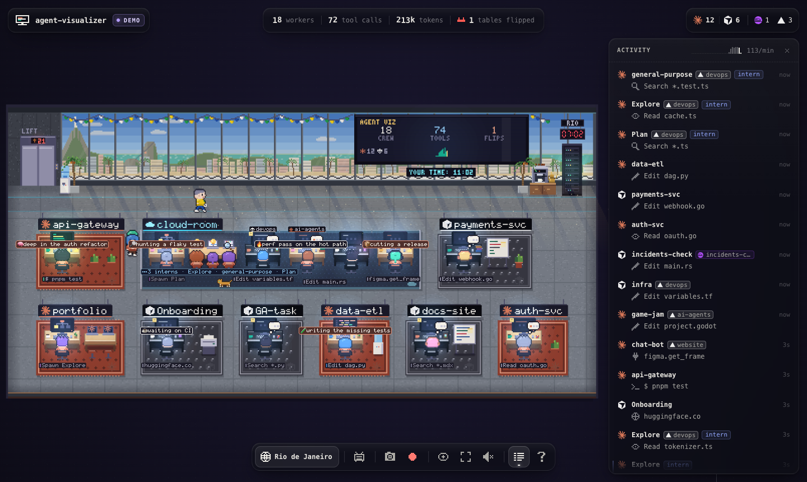
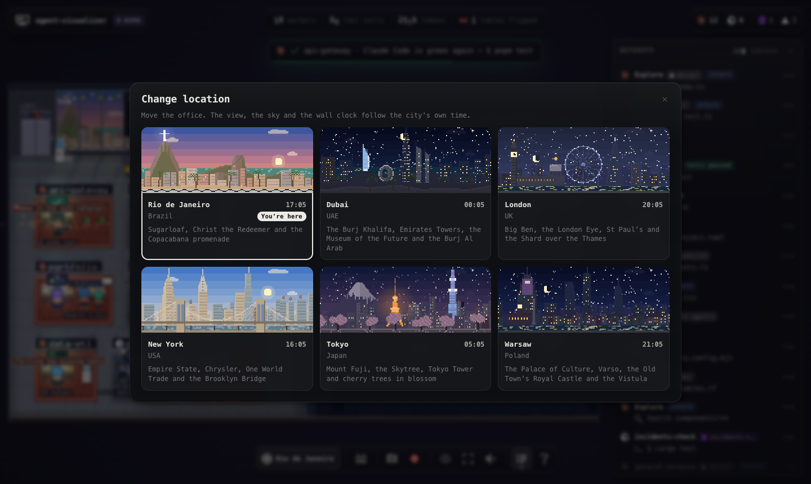

# agent-visualizer

[](https://pvgomes.com/)
[](tsconfig.json)
[](package.json)

Your coding agents as little workers in a pixel-art office, on the 21st floor in Rio de Janeiro, Dubai, London, New York, Tokyo or Warsaw.

Every Claude Code, Codex, Cursor or other agent session you run gets a desk. You can see at a glance who is working, who is waiting on you, and who just broke the tests.



## Use

You need Node 18 or newer (and git). No clone needed, it installs straight from GitHub:

```sh
npx github:pvgomes/agent-visualizer          # open the office with your real agents
npx github:pvgomes/agent-visualizer --demo   # a busy pretend office, to look around
```

Or install it once and use the short command (needed for `agent-visualizer install`, below). npm builds it from GitHub into a package file, then installs that:

```sh
npm pack github:pvgomes/agent-visualizer        # writes pvgomes-agent-visualizer-<version>.tgz here
npm install -g ./pvgomes-agent-visualizer-*.tgz
agent-visualizer
```

(`npm install -g github:pvgomes/agent-visualizer` in one step doesn't work: current npm links global installs from git to a temporary folder it then deletes.)

The first run builds the CLI, so it takes a minute; later runs start at once.

> An npm package (`npx @pvgomes/agent-visualizer`) is coming soon.

Your browser opens `http://127.0.0.1:4747`. Start an agent in any terminal and it walks into the office; quit it and it leaves.

## What you see

- **A desk per project**, a worker per agent session, and interns for subagents.
- **A raised hand** means the agent is waiting on you.
- **A flipped table** means a test just failed.
- **The TV** counts workers, tool calls and flips.
- **Change location** (next to Add agent, or `L`) moves the office to Rio de Janeiro (the default), Dubai, London, New York, Tokyo or Warsaw.
- **The clock** shows the city's time; the strip under the TV shows yours.
- **The view** follows the time in that city: dawn, day, sunset and night.



Works with Claude Code, Codex, Command Code, opencode, Cursor (the editor and cursor-agent), GitHub Copilot (VS Code and the Copilot CLI), Droid, Qwen Code and Gemini CLI. Agents running inside your editor show up just like the ones in a terminal.

## More

- **Add agent** on the page starts an agent from the office and gives you its terminal.
- `agent-visualizer install` lets your agents talk to the office (an MCP server and a skill); `agent-visualizer uninstall` removes it.
- `agent-visualizer --name "Paulo"` puts your name on the office TV.
- `agent-visualizer --help` lists every option, for example `--port`, `--no-open` or `--no-control` (watch only).

Everything runs on your machine. The page shows labels like "Read router.ts", never your prompts, file contents or keys.

## From source

```sh
git clone git@github.com:pvgomes/agent-visualizer.git
cd agent-visualizer
npm install                 # installs esbuild etc. and builds dist/
node dist/cli.js --demo
```

MIT licensed, see [LICENSE](LICENSE).


---

Powered by [pvgomes](https://pvgomes.com/).
