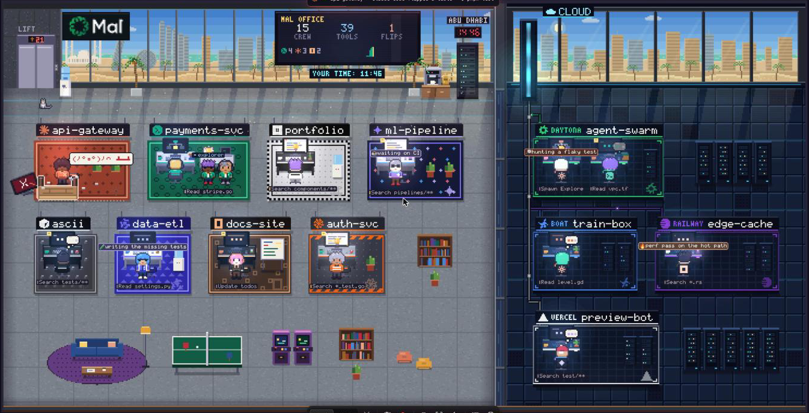

# agent-visualizer

[](https://pvgomes.com/)
[](tsconfig.json)
[](package.json)

Your coding agents as little workers in a pixel-art office, on the 21st floor in Rio de Janeiro, Dubai, London, New York, Tokyo or Warsaw.

Every Claude Code, Codex, Cursor or other agent session you run gets a desk. You can see at a glance who is working, who is waiting on you, and who just broke the tests.



## Install

You need Node 18 or newer and access to this repository (an SSH key on GitHub, or `gh auth login`).

```sh
git clone git@github.com:pvgomes/agent-visualizer.git
cd agent-visualizer
npm install                 # installs esbuild etc. and builds dist/
npm install -g "$(npm pack --silent | tail -1)"
```

Run the same command again to update.

## Use

```sh
agent-visualizer          # open the office with your real agents
agent-visualizer --demo   # a busy pretend office, to look around
```

Your browser opens `http://127.0.0.1:4747`. Start an agent in any terminal and it walks into the office; quit it and it leaves.

## What you see

- **A desk per project**, a worker per agent session, and interns for subagents.
- **A raised hand** means the agent is waiting on you.
- **A flipped table** means a test just failed.
- **The TV** counts workers, tool calls and flips.
- **Change location** (next to Hire, or `L`) moves the office to Rio de Janeiro (the default), Dubai, London, New York, Tokyo or Warsaw.
- **The clock** shows the city's time; the strip under the TV shows yours.
- **The view** follows the time in that city: dawn, day, sunset and night.

Works with Claude Code, Codex, Command Code, opencode, Cursor, Droid, Qwen Code and Gemini CLI.

## More

- **Hire** on the page starts an agent from the office and gives you its terminal.
- `agent-visualizer install` lets your agents talk to the office (an MCP server and a skill); `agent-visualizer uninstall` removes it.
- `agent-visualizer --help` lists every option, for example `--port`, `--no-open` or `--no-control` (watch only).

Everything runs on your machine. The page shows labels like "Read router.ts", never your prompts, file contents or keys.


---

Powered by [pvgomes](https://pvgomes.com/).
